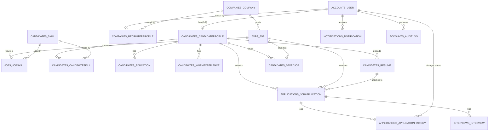

# HireFlow database schema

MySQL 8.4, character set `utf8mb4`. Django creates every table from the models, so you never write `CREATE TABLE` by hand.
Table names are `<app>_<model>` in lowercase, for example `jobs_job`. Every table also has an `id` BIGINT primary key (auto-increment).

## ER diagram (Mermaid)

## How the tables connect (plain English)

* A **User** logs in with an email. Its `role` says whether it is a candidate, recruiter or admin.
* A candidate User has exactly **one** `CandidateProfile`; a recruiter User has exactly **one** `RecruiterProfile` (one-to-one).
* A **Company** can employ many recruiters and own many jobs (one-to-many).
* A **Job** needs many skills and a **Skill** is used by many jobs: a many-to-many relationship, stored in the link table `JobSkill`.
  Candidates and skills work the same way through `CandidateSkill`.
* A candidate **applies** to a job: that creates one `JobApplication` row (it links the candidate, the job and the chosen resume).
  A database **unique constraint on (job, candidate)** makes a second application to the same job impossible.
* Each status change adds an `ApplicationHistory` row. Each interview round is an `Interview` row linked to the application.

## Tables

Legend: PK = primary key, FK = foreign key, UQ = unique. Timestamps (`created_at`, `updated_at`) are filled in automatically.

### 1. accounts_user (custom User)
| Column | Type | Notes |
|---|---|---|
| id | BIGINT | PK |
| email | VARCHAR(254) | UQ, used to log in |
| password | VARCHAR(128) | hashed (PBKDF2), never plain text |
| full_name | VARCHAR(150) | |
| role | VARCHAR(20) | candidate / recruiter / admin, indexed |
| is_active, is_staff, is_superuser | BOOLEAN | permission flags |
| last_login, created_at, updated_at | DATETIME | |

### 2. candidates_candidateprofile
| Column | Type | Notes |
|---|---|---|
| user_id | BIGINT | FK to User, **UQ** (one-to-one) |
| phone, location, headline, summary, portfolio_url | text fields | all optional |
| years_experience | SMALLINT | optional |
| created_at, updated_at | DATETIME | |

Extra tables for profile sections: `candidates_education` (degree, institution, years), `candidates_workexperience`
(title, company, dates, `is_current`), both FK to the profile.

### 3. companies_company
| Column | Type | Notes |
|---|---|---|
| name | VARCHAR(200) | |
| website, industry, size, description, location | text fields | |
| verification_status | VARCHAR(10) | pending / verified / rejected, indexed |
| verification_note, verified_at | TEXT, DATETIME | filled when an admin decides |

### 4. companies_recruiterprofile
| Column | Type | Notes |
|---|---|---|
| user_id | BIGINT | FK to User, **UQ** (one-to-one) |
| company_id | BIGINT | FK to Company (nullable, SET NULL on delete) |
| designation | VARCHAR(100) | |

### 5. jobs_job
| Column | Type | Notes |
|---|---|---|
| company_id | FK | the owning company (CASCADE) |
| created_by_id | FK | recruiter User (SET NULL) |
| title, description, responsibilities, location | text | |
| employment_type | VARCHAR(20) | full_time, part_time, contract, internship, freelance |
| experience_min, experience_max | SMALLINT | **CHECK** min <= max |
| salary_min, salary_max, salary_currency | INT, INT, CHAR(3) | optional |
| deadline | DATE | |
| status | VARCHAR(10) | draft / published / paused / closed |
| published_at, closed_at | DATETIME | |
| is_featured, is_hidden_by_admin, moderation_note | BOOL, BOOL, TEXT | admin moderation |

Indexes: (status, deadline), location, employment_type, title.

### 6. candidates_skill
`name` VARCHAR(60) **UQ**. Shared by candidates and jobs.

### 7. candidates_candidateskill
FK candidate, FK skill, `proficiency`. **UQ (candidate, skill)**.

### 8. jobs_jobskill
FK job, FK skill, `is_required`. **UQ (job, skill)**.

### 9. candidates_resume
FK candidate, `file` (path inside the private folder `media_private/`), `original_name`, `file_type`, `file_size`,
`is_default`, `uploaded_at`. The real file name on disk is random (UUID).

### 10. applications_jobapplication
| Column | Type | Notes |
|---|---|---|
| job_id | FK | CASCADE |
| candidate_id | FK | CASCADE |
| resume_id | FK | **PROTECT** (a resume used in an application cannot be deleted) |
| status | VARCHAR(25) | submitted, under_review, shortlisted, interview_scheduled, interview_completed, selected, rejected, withdrawn |
| cover_letter | TEXT | optional |
| applied_at, updated_at | DATETIME | |

Constraint: `unique_application_per_candidate_job` = UNIQUE (job_id, candidate_id). Indexes on status and applied_at.

### 11. applications_applicationhistory
FK application, FK changed_by (User, SET NULL), `old_status`, `new_status`, `note`, `changed_at`. Append-only.

### 12. interviews_interview
FK application, `round_number`, `scheduled_at`, `duration_minutes`, `mode` (online/phone/onsite), `meeting_details`
(link or address), `interviewer_name`, `status` (scheduled/completed/cancelled/no_show), `feedback`, `rating` (1-5), `created_by`.
Feedback is shown to recruiters of the company only.

### 13. notifications_notification
FK user, `title`, `message`, `notification_type`, `link`, `is_read`, `created_at`. Index (user, is_read, created_at).

### Extra tables
* `candidates_savedjob`: FK candidate, FK job, **UQ (candidate, job)**.
* `accounts_auditlog`: actor, action, target, details, created_at (admin actions).
* `authtoken_token`: API tokens (from Django REST Framework).

## Transactions
`apply_to_job`, `change_status`, `schedule_interview`, `register_user` and `change_job_status` run inside
`transaction.atomic`, so a half-finished change (for example an application without its history row) cannot be saved.

## Inspecting the tables in MySQL Workbench
1. Open Workbench and connect to your local MySQL instance.
2. In the left **Schemas** panel, right-click **hireflow** and choose *Set as Default Schema*.
3. Expand **Tables**. Click a table, then the small "table" icon to browse rows.
4. For a diagram: menu **Database > Reverse Engineer...**, choose the `hireflow` schema and finish the wizard.
